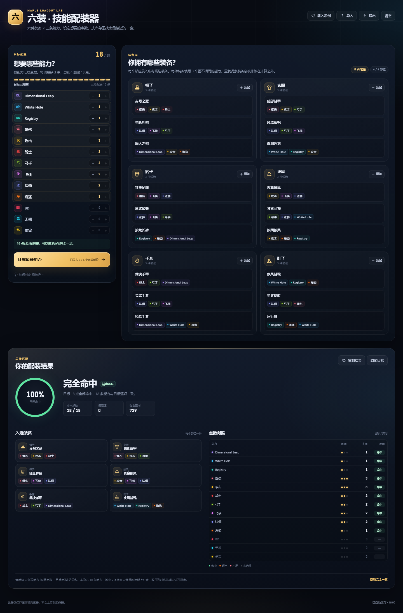
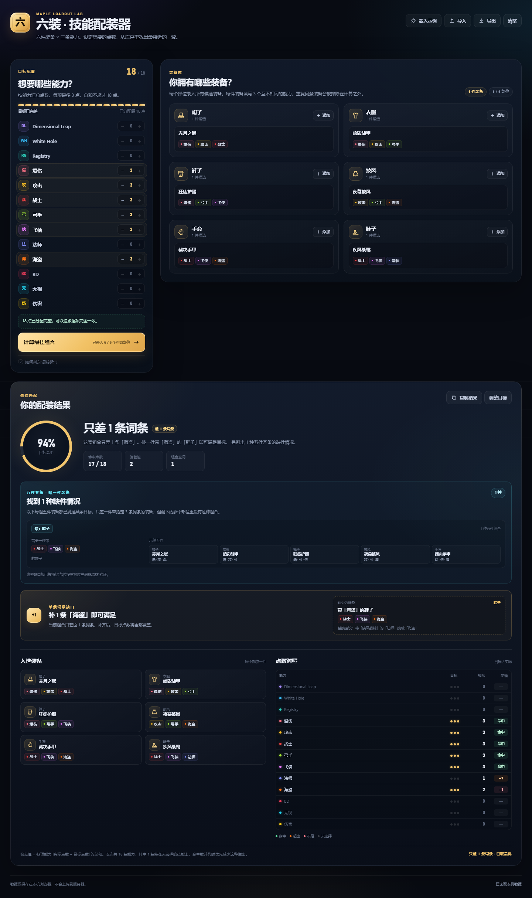

# 六装 · 技能配装器

一个纯前端、本地运行的装备技能配装工具。录入库存后，从六个部位各选一件装备，找出最接近目标能力点数的那一套。



## 快速开始

1. 用 Chrome 或 Edge 打开 `index.html`。
2. 在左侧「目标配置」中设置想要的能力点数。
3. 在右侧「装备库」中为帽子、衣服、裤子、披风、手套、鞋子录入候选装备。
4. 点击「计算最佳组合」。

也可以直接打开 `index.html?demo=1` 载入示例数据并立即看到计算结果。

所有数据都保存在当前浏览器的 `localStorage` 中，不会上传。需要备份或换浏览器时，使用右上角的「导出」和「导入」。

## 规则

- 共 6 个部位，每个部位选 1 件装备。
- 每件装备恰好有 3 个能力，六件合计 18 条能力。
- 每一条能力计 1 点。
- 13 种能力中，每种目标最多 3 点，目标总和最多 18 点。
- 同一件装备的 3 个能力必须互不相同；含重复词条的装备不会参与组合，也不会出现在结果中。
- 必须六个部位都至少录入 1 件装备才能计算。

目标总和不足 18 点时，由于最终一定有 18 条能力，必然会有能力落在目标之外。系统仍会优先覆盖已填写的目标，并把多余点数尽量放在你选择过的技能上。

## 五件齐备，缺一件装备

当目标无法完全满足时，系统会检查全部“任意 5 个部位”的装备组合：

1. 这 5 件装备已经满足其余目标，只差 3 条词条；
2. 剩下的那个部位里，没有任何一件装备刚好带这 3 条词条。

只要同时满足，就会列出来告诉用户。每条结果包含：

- 缺少哪一件装备、属于哪个部位
- 缺少的 3 条具体词条（3 条互不相同）
- 一组满足其余目标的 5 件示例装备
- 有多少种五件组合都指向这个缺口
- 其他可展开查看的缺口情况



例如截图中的情况：帽子、衣服、裤子、披风、手套这五件已经覆盖了其余目标，只差一件带「战士 / 飞侠 / 海盗」的鞋子，但鞋子部位只有「战士 / 飞侠 / 法师」，因此系统会把这一组五件组合和缺少的整件装备列出来。

如果当前最优六件组合只差 1 条词条，结果中还会额外给出“单条词条缺口”的替换建议，作为补充信息。

## “最接近”的判定

先把每种能力的实际点数与目标点数逐项比较：

```text
命中点数 = Σ min(实际点数, 目标点数)
偏差值   = Σ |实际点数 − 目标点数|
```

在固定 18 条能力的前提下，最大化命中点数等价于最小化偏差值。命中数并列时，系统优先选择“多余能力落在已选择技能上”更多的组合，以减少完全不需要的能力。

计算使用混合进制动态规划，按部位逐层合并状态。状态只记录目标技能的封顶点数，因此不需要暴力枚举所有装备组合；即使库存很大，也能得到精确最优解。

五件齐备分析会依次假设“被剩下的部位”是帽子、衣服、裤子、披风、手套或鞋子，对另外五个部位做同样的状态合并，筛出缺口恰好为 3 条词条的状态。随后检查剩余部位的装备是否具备完全相同的三词条组合；若没有，就记录该五件组合。状态数上限约为 2.6 万，因此不需要枚举全部五件组合。

得到最优组合后，还会做一次单条词条缺口分析：如果只缺 1 点，就在六个已选装备中寻找“含有多余词条”的位置，模拟替换后是否能满足目标，作为补充建议。

## 文件说明

| 文件 | 作用 |
| --- | --- |
| `index.html` | 页面结构、SVG 图标 |
| `styles.css` | 完整视觉样式与响应式布局 |
| `engine.js` | 能力/部位定义、校验、精确匹配算法 |
| `app.js` | 界面渲染、弹窗、导入导出、本地存储 |
| `tests/engine.test.js` | 算法测试（含随机对拍暴力枚举） |
| `screenshots/` | 桌面端、移动端、五件齐备缺口与录入弹窗截图 |

## 算法测试

安装 Node.js 后，在项目目录执行：

```powershell
node tests/engine.test.js
```

测试会把动态规划结果与随机小规模库存的暴力枚举结果逐项对照，并覆盖完全命中、缺少部位、零目标、单条缺口、五件齐备缺整件、重复词条排除和多条缺口等场景。

## 数据格式

导出的 JSON 可以直接再次导入：

```json
{
  "version": 1,
  "target": {
    "dimensional_leap": 1,
    "white_hole": 1,
    "registry": 1,
    "crit_damage": 3,
    "attack": 3,
    "warrior": 2,
    "archer": 2,
    "thief": 2,
    "mage": 2,
    "pirate": 1,
    "boss_damage": 0,
    "ignore_defense": 0,
    "damage": 0
  },
  "items": [
    {
      "id": "sample-hat-1",
      "slot": "hat",
      "name": "赤月之冠",
      "abilities": ["crit_damage", "attack", "warrior"]
    }
  ]
}
```

`slot` 可选值：`hat`、`top`、`bottom`、`cape`、`gloves`、`shoes`。

能力 ID：

| ID | 显示名 |
| --- | --- |
| `dimensional_leap` | Dimensional Leap |
| `white_hole` | White Hole |
| `registry` | Registry |
| `crit_damage` | 爆伤 |
| `attack` | 攻击 |
| `warrior` | 战士 |
| `archer` | 弓手 |
| `thief` | 飞侠 |
| `mage` | 法师 |
| `pirate` | 海盗 |
| `boss_damage` | BD |
| `ignore_defense` | 无视 |
| `damage` | 伤害 |

## 浏览器说明

推荐使用较新的 Chrome / Edge。页面用到原生 `<dialog>`、CSS `color-mix()` 和 `localStorage`。直接双击以 `file://` 打开即可；如果浏览器策略禁止本地存储，页面仍可正常计算，但自动保存和读取会失效，此时请用导入/导出备份数据。
